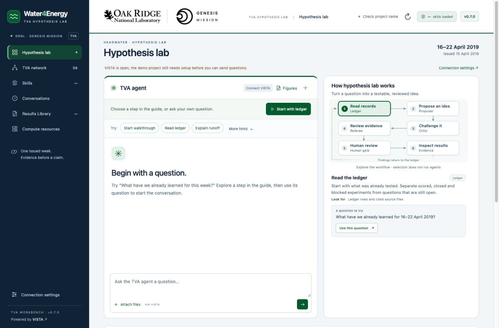

# TVA Workbench · Hypothesis-lab demo · v0.7.0

A local ORNL/Genesis interface for Dali's HEADWATER hypothesis-lab walkthrough. The case is fixed: **16–22 April 2019, issued 15 April 2019**. VISTA supplies the live agent, loaded skills, knowledge bases and saved files.



## Launch

Extract the complete **TVA-Workbench-v0.7.0.zip**, then double-click **Start TVA Workbench.command** inside its `TVA-Workbench` folder on macOS. Keep the Terminal window open. Windows uses **Start TVA Workbench.bat** with Python 3.9+; Linux uses `sh start.sh`. Terminal users can run `python3 server.py`.

The launcher prints the version, folder and actual local URL, and opens a browser tab. It prefers port 8765. If another copy occupies that port, this version uses an available loopback port without stopping the other process. Opening this same copy again reuses its validated running instance. Follow the printed URL; an older tab on port 8765 may belong to another version. Control+C stops this wrapper.

No npm, pip or frontend build is required. The launcher uses VISTA's bundled Python if available, otherwise Python 3.9+. The interface can open before VISTA is configured; readiness and missing artifacts remain explicit.

## Start with a conversation

The **Hypothesis lab** opens with a large conversation on the left and an interactive workflow guide on the right. Start with **Read the ledger**, then explore Proposer, Critic, Referee, human review and evidence. Each step explains its purpose and shows a plain-language question. Selecting a step explores the idea; **Use this question** puts an editable request into the chat, with that question first and the fixed-case/source instructions below it. Review the request and press **Send** to call VISTA.

The diagram describes the research loop; its highlighted step is a selection, not execution progress. Human review does not grant approval or start training. **Inspect results** explains the fixed evidence and offers a button to open the case figures. On narrow screens the guide stacks above the conversation. Existing hints remain in chat and **Conversations**, with additional questions under **More hints**.

Case figures, the lab loop, project/source readiness, optional reservoir readout, walkthrough questions and conversation artifacts start collapsed below the chat. Open only the section needed, or use **Figures** in the chat header. Streaming, tool activity and Stop remain in the conversation area.

In **TVA network**, the 12 headwaters start expanded and the other 42 locations start collapsed. Expand either group as needed. Searching reveals matching locations automatically; clearing the search restores your expansion choices.

## What the walkthrough shows

- Project, eight required skills, actual knowledge-index status and the six lead-source checks.
- The ledger-first loop: ledger → Proposer → Critic → Referee → human approval → evidence back to the ledger. Buttons prepare editable requests; they do not start a multi-agent run by themselves.
- Temperature and precipitation from the frozen climate-week plus residual 9×9 result.
- **Observed ERA5 surface runoff**, with the HEADWATER runoff forecast explicitly unavailable.
- Frozen **Trial 0, 1° → 0.25°** downscaling beside bilinear, scored 7 September 2026.
- An optional, off-by-default dam panel. Select Normandy or Norris and provide the agreed rule before preparing `dam.readout`. The interface does not infer a fill/hold policy.

The evidence cards read a matching manifest and existing files from the selected VISTA project's outputs. They do not turn arbitrary images into case results. Metadata and file-presence checks are not an independent scientific re-score. No prediction arrays, private ledger, checkpoints or example scientific results are bundled.

The 54-location study network, 12-headwater grouping, conversations, Results Library and resource status remain secondary views. General conversation files remain separate from the fixed-case evidence cards. The native VISTA Hypothesis Lab debate page is not required: this interface follows the HEADWATER checkout's research loop through VISTA skills.

## Connect the science backend

Open VISTA separately. The default project is **Water4Energy-TVA-agent-loop** and backend is `http://127.0.0.1:8001`. Each laptop needs its own project, skill loading, knowledge indexing and staged source files. The package does not create or train these automatically.

See **[VISTA_SETUP.md](VISTA_SETUP.md)** for the eight skills, optional dam skill, lead knowledge sources and evidence-manifest contract. The current interface can be fully inspected with missing dependencies; a scientific walkthrough requires those dependencies to be supplied.

A starter or loop button fills the composer. Review the text and click Send to call the real VISTA agent. The six cold-open questions provide the demo acceptance checklist. Completion of a chat turn is not proof that a scientific test passed or a scheduler job completed.

## Storage and scope

VISTA owns saved outputs, history and credentials. Results Library browses the selected project's output directory and supports search, filters, passive figure previews and original downloads. Chat attachments supply input files. Export brief creates a Markdown download from the selected conversation.

The wrapper stores only backend/project selection and validated launch-port metadata under ignored `.local/`. It binds to loopback only. No new training, ERA5 download, RiverWare, river temperature or plant-MW calculation is part of this walkthrough. A figure redraw needs its own explicit request and supported runtime.

## Source and versions

[Dali's plan](https://github.com/daliwang/HEADWATER/blob/main/docs/TVA_AGENT_DEMO_PLAN_20261102.md), [HEADWATER lab](https://github.com/daliwang/HEADWATER/blob/main/hypothesis_lab/README.md), [runtime](https://github.com/daliwang/HEADWATER/blob/main/hypothesis_lab/RUNTIME.md).

| Tag | Interface |
| --- | --- |
| v0.2.1 | Full original interface |
| v0.3.0 | Simplified presentation |
| v0.4.0 | Full live workspace and Results Library |
| v0.5.0 | Fixed April 2019 hypothesis-lab walkthrough |
| v0.6.0 | Chat-first walkthrough, integrated hints and collapsible network |
| v0.7.0 | Hypothesis lab with a conversation and interactive workflow guide |

Earlier versions remain in Git history. Clone `https://github.com/cheny-4/tva-workbench.git` or use GitHub's Code → Download ZIP. GitHub hosts source; the Python/VISTA app runs on the laptop.

## Development

The app is vanilla HTML/CSS/JavaScript with a Python standard-library adapter. `hypothesis-guide.js` owns the educational workflow diagram; `hypothesis-demo.js` owns case/readiness/artifact validation; `project-ui.js` owns secondary views; `results-library.js` browses stored outputs. Brand assets remain local and proportional. See [BRANDING.md](BRANDING.md), [DATA_NOTES.md](DATA_NOTES.md), [WORKFLOW_NOTES.md](WORKFLOW_NOTES.md), [BACKEND.md](BACKEND.md) and [VERIFICATION.md](VERIFICATION.md).

```sh
python3 -m unittest discover -s tests -v
node --test tests/*.cjs
```

Node is only needed for developer checks. Release archives omit `.git/`, `.local/`, credentials and caches.
