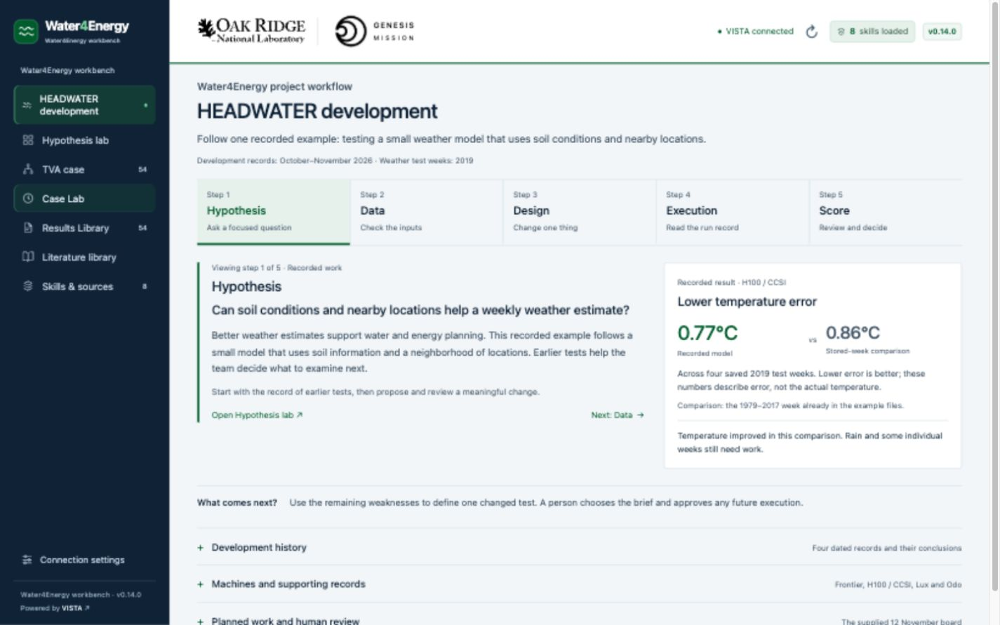

# Water4Energy workbench · v0.14.1

The **Water4Energy workbench** opens on **HEADWATER development**: a guided explanation of one recorded weather-model development example. **TVA · 16–22 April 2019** remains one selectable case inside the project. The product name stays Water4Energy workbench on every screen.



## Launch the combined package

1. Extract **Water4Energy-Workbench-v0.14.1-All-in-One-Mac.zip** into a writable folder.
2. Double-click **Start TVA Workbench.command** inside `TVA-Workbench`.
3. Keep Terminal and VISTA open while using the page.

The launcher opens installed VISTA, creates or upgrades the dedicated project, loads eight replay skills, indexes eight bundled documents, stages the saved evidence, and opens this exact interface copy. Source indexing may take a few minutes. The recipient needs their own installed VISTA and working model credentials. VISTA normally supplies Python; Python 3.9+ can also open the interface for design review. No npm or pip commands are needed.

The printed local URL is authoritative. If port 8765 is occupied, this copy uses an available loopback port without stopping the existing process. Reopening the same copy reuses only its validated folder/version/connection. Ctrl+C stops the wrapper; VISTA remains under its application's control. The retained Windows/Linux companion entry points use the same setup path; desktop launch verification is performed on macOS.

Known original **v0.13.1 and v0.13.2** demo installations can be upgraded after verification and a local backup. The installer preserves unknown edits, shared global skills and differing evidence rather than replacing them. Matching saved files keep their bytes and timestamps. If setup needs attention, Terminal explains it and the webpage remains available for design review. See **READ ME FIRST.txt** for details.

The ZIP includes pinned source snapshots, project setup and saved evidence. It excludes account secrets, local databases, chats, cluster credentials, raw ERA5 arrays and checkpoints. VISTA and model credentials are not redistributed.

## Start the demonstration

The first page explains the recorded example in plain language: can a small weather model use soil conditions and nearby locations to improve a weekly estimate? Explore five steps, using the stage buttons or **Next**:

| Step | What the audience follows |
| --- | --- |
| **Hypothesis** | Ask a focused question and start from earlier tests |
| **Data** | Check which inputs were documented as available |
| **Design** | Name a specific change that can be compared |
| **Execution** | Connect the written test with a recorded machine/run |
| **Score** | Keep the improvement, limitations and next decision together |

The visible result is the **H100 / CCSI** model's temperature error across four saved 2019 target weeks: **0.77 degrees Celsius** against **0.86 degrees Celsius** for **the 1979–2017 week already in the example files**. Lower error is better. These are error measures, not actual air temperatures or a score for the April week alone. The comparison does not isolate the contribution of soil information alone. Rain and some individual weeks remain weak.

**Development history** opens four source-linked records: the 21 October inventory, 26 October ledger, 6 November review pack and 12 November supplied demo record. These are documentation dates in **2026**, not training start/completion times. The weather test weeks are in **2019**. The table connects each record with its conclusion and next decision.

Machine details and the supplied 12 November board open on demand. The H100 card names `det_v2_soil_k9`, fit on 1979–2017, stopped on 2018 and scored on 2019. Lux lists its nine recorded run names without borrowing the H100 temperature result; its score files are on Lux, not in this checkout. Resource badges describe connectivity separately from the historical record.

The next experiment is not chosen by the walkthrough. The 6 November pack contains several proposed tests; the supplied files do not establish which one a person selected as the current one-change brief. Both H100 and Lux training flags are off in the supplied 12 November record. Clicking a stage opens an explanation and never starts an agent or job.

## Questions and the evidence workspace

**Case Lab** keeps chat on the left and saved evidence on the right. Select a suggested question, review its editable request, then press **Send**. Preparing a request does not send it.

HEADWATER retains five primary questions:

- What has the ledger already scored?
- What is the one change in the current brief?
- What did Frontier already prepare?
- Which board rows are ready, and which training flags are off?
- What did the 2019 valley score return?

Each request explicitly selects the matching HEADWATER reader/profile. It asks for an explicitly labelled, source-checked saved-evidence answer with readable source links. Missing evidence or a missing selected brief must be stated. A historical board flag is not approval for a new run. The optional history action, inside the history disclosure, prepares a source-based retrospective and can display its CSV.

The right-hand HEADWATER workspace explains the saved record relevant to the selected question: results, review choices, input inventory, board, score or dated history. It is a source-based explanation, not a signal that an agent stage completed. Sources and technical details open separately. Saved proposal, critique and referee artifacts for HEADWATER refer to the same November review pack, with distinct output names from the April case.

**Hypothesis lab** retains the six-node research method. Its question buttons select the matching HEADWATER saved record while preserving the role's question and the human approval gate. They do not run a new multi-agent review.

Opening the **TVA case** changes the Case Lab context to **16–22 April 2019, issued 15 April 2019**. Its six existing guided questions, original guarded catalog and April evidence contract are retained. Weather maps are frozen `det_v2_soil_k9` results; runoff is an observed ERA5 receipt summary without a supplied HEADWATER forecast; Trial 0 is a separate frozen downscaling comparison with aggregate test-split scores. A network selection does not change the week or establish an operating rule.

Actual successful file displays select the relevant April evidence card. Manual review pauses following; **Resume** returns to the latest actual display. Replay preserves identical figure bytes and timestamps so later reads do not invalidate valid history. Changed or missing records remain excluded.

Each context retains its own draft, remembered conversation and evidence state. The switcher is disabled during a turn, and late reads from another context/session cannot replace the active one. **History** reopens conversations and artifacts. Drag **Adjust message box** vertically, or use its keyboard controls, to resize the composer. Evidence stacks below chat on narrow screens.

## Navigation and libraries

| Tab | Purpose |
| --- | --- |
| **HEADWATER development** | Start with the recorded development example |
| **Hypothesis lab** | Explore the project research method |
| **TVA case** | Introduce the loaded case, 54 study locations and decisions |
| **Case Lab** | Ask about the active context and inspect its evidence |
| **Results Library** | Compact rows for saved outputs, previews and downloads |
| **Literature library** | Search the project paper/reference catalog |
| **Skills & sources** | Inspect loaded capabilities and source coverage |

Libraries remain project-wide. The literature page retains its 42-record snapshot checked on 9 November 2026; repair flags and missing-paper references remain visible. Paper bytes and GitHub credentials are not bundled. Reloading the catalog reads the packaged snapshot.

Connection settings is the only interface control that saves the backend address and project name. Defaults remain `http://127.0.0.1:8001` and **`Water4Energy-TVA-agent-loop`**. Switching between HEADWATER and TVA never creates another project. The source index has the original six lead documents plus the TVA answer guide and HEADWATER development guide. An indexed source count or connection badge does not establish a scientific result or model access.

## Supplied media and remaining boundaries

Dali's demonstration video/captions, approved April home-score map and voiceover remain supplied content. Until those files arrive, the video is hidden and the score frame stays labelled empty inside **April case evidence**. The four-week numerical comparison is separate from that map slot.

The local media endpoint recognizes only:

- `public/assets/water4energy-workbench-90s.mp4`
- `public/assets/water4energy-workbench-90s.vtt`
- `public/assets/water4energy-april-2019-score.png` or `.jpg`

The video requires both MP4 and captions, plays on click and has no autoplay. Reopening the workbench after adding the supplied files enables the corresponding mount. No substitute map is generated.

The exact original Trial 0 scorer command remains unavailable and is reported as missing. The optional dam skill remains uninstalled until an agreed reservoir and fill/hold rule exist. Saved readouts do not create a new experiment, review, score or execution approval. A person controls Send and any future execution.

## Sources, versions and development

This revision builds on [Dali's 12 November action list](https://github.com/daliwang/water4energy_SC26Demo/blob/d9c185da04bb72e51414c72c4004447cd38292ee/Water4Energy_Workbench_Actions_20261112.md) and the supplied development discussion. Pinned source commits and SHA-256 receipts accompany the backend readers. The original April catalog, case definition, evidence schema and partner marks are retained. The embedded `0.12.1` in `demo-case.json` is case metadata; the independent interface/setup version is **0.14.1**.

| Tag | Interface |
| --- | --- |
| v0.2.1 | Full original interface |
| v0.3.0 | Simplified presentation |
| v0.4.0 | Full live workspace and Results Library |
| v0.5.0 | Fixed April 2019 hypothesis-lab walkthrough |
| v0.6.0 | Chat-first walkthrough, integrated hints and collapsible network |
| v0.7.0 | Hypothesis lab with a conversation and interactive workflow guide |
| v0.8.0 | Full-height lab with supporting information in its relevant views |
| v0.9.0 | Conversation-following guide, inline figures, adjustable input, compute settings and literature |
| v0.10.0 | Quiet two-column research desk, single welcome and focused evidence viewer |
| v0.11.0 | Restored brand colors and interactive workflow, compact libraries and lab History |
| v0.12.0 | Separate method/case introduction, TVA decision context and guided TVA Case Lab |
| v0.12.1 | Remove the introduction footer and two technical source/readiness disclosures |
| v0.13.0 | Water4Energy project identity, HEADWATER development home and context-switched TVA case |
| v0.13.1 | Current VISTA skill-name and indexed-document compatibility; connected replay setup |
| v0.13.2 | Source-bound answer briefs, stable evidence replay, figure following/history fixes, and one combined setup package |

| v0.14.0 | Plain-language HEADWATER recorded cycle, dated history, context-specific questions and corrected review artifacts |
| v0.14.1 | Clickable VISTA GitHub credit in the combined Mac package |

Earlier versions remain in Git history at `https://github.com/cheny-4/tva-workbench.git`. ORNL and Genesis marks are retained.

The app uses vanilla HTML/CSS/JavaScript and a Python standard-library wrapper. `headwater-workflow.js` owns the recorded story, questions, history and saved-evidence explanations; `app.js` owns conversation/context state; `backend/replay.py` owns source-checked reader profiles. VISTA owns credentials, conversations and project files. Ignored `.local/` holds connection/launch metadata, non-secret setup receipts and upgrade backups; do not forward it.

Run the existing checks and consult [VERIFICATION.md](VERIFICATION.md) for the final validation results:

```sh
python3 -m unittest discover -s tests -v
python3 -m unittest discover -s backend/tests -v
node --test tests/*.cjs
```

Node is needed only for developer checks. Build the complete ZIP with `python3 tools/build_release.py --output /path/to/output`. See [BACKEND.md](BACKEND.md), [VISTA_SETUP.md](VISTA_SETUP.md), [WORKFLOW_NOTES.md](WORKFLOW_NOTES.md), [BRANDING.md](BRANDING.md) and [DATA_NOTES.md](DATA_NOTES.md) for technical contracts and source notes.

Guided sent requests show the question first, with the complete instructions under **Request details**. An unreadable tool-protocol response is shown as an unavailable answer with **Prepare question again**; retry still requires a person to press Send. The response is not replaced by a fabricated result.

The **Powered by VISTA** credit opens [VISTA’s GitHub repository](https://github.com/Genesis-VISTA/vista) in a new tab. v0.14.1 retains the v0.14.0 backend payload without a skill migration.
