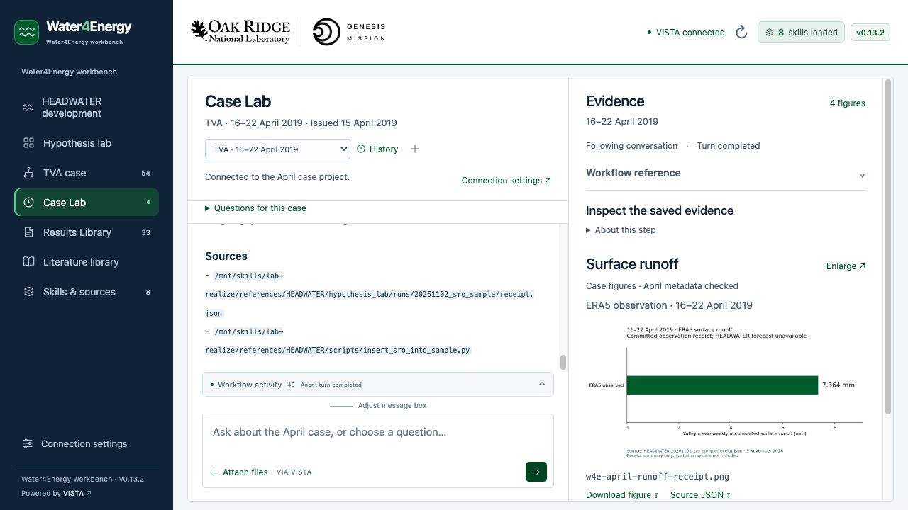

# v0.13.2 verification

The six guided April demo questions passed live acceptance against the configured VISTA agent on 12 November 2026 (13 November UTC). The final guided requests explicitly identify a **Saved-evidence answer**, select the matching reader/question profile, require its verified narrative and actual file displays, and retain the original case guard. The frontend does not intercept or replace agent responses.

## Live acceptance

| Question | Result | Checked behavior |
| --- | --- | --- |
| Ledger findings | Pass | April and four-week RMSE remain distinct; no invented threshold, exhaustive gap claim or training approval |
| Saved weather | Pass | Correct year, stored reference versus model, five original columns and weekly rainfall units; three PNG displays |
| Frozen Trial 0 | Pass | Standardized 730-day aggregate versus 19 April illustration, degrees, variable-specific comparisons and no unsupported coupling claim; two PNG displays |
| Observed runoff | Pass | ERA5 7.364 mm weekly valley receipt, derived chart versus spatial map, no supplied forecast/inflow claim; PNG and source JSON displays |
| Open reviewed test | Pass | Archived role pack exists; later F1 and spring scores are completed; the remaining mechanism/rain issue needs a changed proposal and human review |
| Future commands | Pass | Lux recipe does not establish an exact H100 command; historical and 12 November flags are separate; exact Trial 0 scorer reported missing; inspection JSON displayed |

The supplemental project-purpose and optional-dam question also passed: Water4Energy is the broader workbench, the April week is one case, and no reservoir, threshold or fill/hold rule is invented. No optional dam skill is installed.

An independent source and response audit checked the final six answers. Actual records included six documented replay readers, four source views, two read-only SKILL reads and eight display_file calls. Every required displayed output had a current backend record. No training, scientific inference/rescoring, dataset download or HPC submission occurred. Earlier failed test rounds are retained locally and are not counted as successful acceptance.

This result applies to the six fixed guided requests in explicit saved-evidence readout mode. Free-form model narration is not covered by this acceptance result. The exact Trial 0 scorer command, raw arrays/checkpoints, Dali's supplied media and an agreed optional dam rule remain outside the package.

## Figure workspace

- A fresh UI test chose the runoff question, sent its actual prepared request, and automatically selected **Surface runoff** after the real display calls. The image loaded at 1367 × 672 with checked case/source-JSON links.
- Manual Temperature selection paused following. Resume returned to the latest actual runoff display.
- Actual weather/downscale replay calls preserved all five PNG modification times; prior conversation display records remained current.
- Bounded run/tool/time identity lets a redisplay focus an existing case card without duplicate thumbnails. Unchanged polling preserves image DOM; changed/missing records remain excluded.



## Automated checks

- **60 Python checks passed**, including adapter scope, launch identity, study catalog and 19 portable-setup tests using the real payload.
- **10 backend reader checks passed**, including both contexts, compact question profiles, source scopes, frozen chart integrity replay byte/timestamp preservation, and isolated HEADWATER/TVA readout filenames.
- **113 JavaScript checks passed**, including six new figure-following regressions and guided profile/guard coverage.

Run:

```sh
python3 -m unittest discover -s tests -v
python3 -m unittest discover -s backend/tests -v
node --test tests/*.cjs
```

The upgrade also ran against actual local VISTA 0.2.4 after the original project policy and complete mounted skill hashes matched the known v0.13.1 snapshot. Original configuration and full skills were backed up under ignored .local/. The project has eight skills, seven indexed sources and 32 staged evidence files. The original 24 evidence files and pinned source snapshots retain their bytes.

## Packaging and retained contracts

The release contains one combined interface/backend-setup ZIP and one Mac launcher. Checks verify every manifest hash, executable launcher mode, archive integrity and absence of local state, credentials, databases, chats and local project IDs. Dali needs installed VISTA and his own model credentials. A fresh extracted Mac folder is checked through its actual launcher, including paths with spaces, occupied-port fallback and the missing-backend review path. A clean installation on Dali's separate laptop cannot be verified from this machine; isolated API tests cover fresh project creation.

The original prompts.json, demo-case.json, April evidence schema and ORNL/Genesis marks retain their approved hashes. The six question labels, hypothesis stages, project ID and launcher filenames remain. Guide changes affect figure presentation/following. The case definition's embedded 0.12.1 remains metadata; the interface/setup version is 0.13.2.
