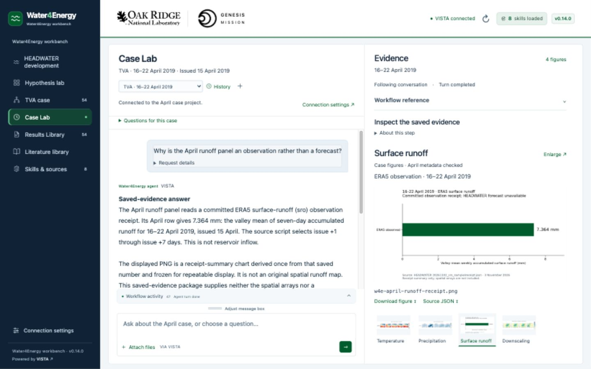

# v0.14.1 package update

This patch adds a clickable **Powered by VISTA** link to `https://github.com/Genesis-VISTA/vista`, opening a new tab with `noopener noreferrer`. The combined Mac ZIP contains that link and consistent interface/setup version labels. The complete backend payload is byte-identical to v0.14.0, so its science validation below remains applicable and an existing matching backend is reused without migration. Package integrity, launcher permissions, local-state exclusions and extracted-launch checks are repeated for this ZIP.

# v0.14.0 verification

Validation completed on 13 November 2026. This release makes the recorded HEADWATER workflow easier to follow, fixes development-context answers and artifact provenance, and retains the April case contract. No training, new scientific inference/scoring, dataset download, flag mutation or HPC submission was performed.

## Live VISTA acceptance

| Guided request | Result | Verified behavior |
| --- | --- | --- |
| HEADWATER ledger | Initial failure; manual retry passed | First provider response contained literal tool framing with zero actual tool calls. Retry read the correct development ledger and returned the H100 four-week comparison, scope and limitations. |
| HEADWATER current brief | Pass | Reports multiple proposals and no identified selected current brief; no invented choice. |
| HEADWATER prepared data | Pass | 153 examples and soil copy, dated inventory rather than live file claim; original 2010/2018 v0 split remains distinct. |
| HEADWATER board | Pass | Historical ready state/flags remain distinct from the supplied 12 November off flags and from execution permission. |
| HEADWATER score | Pass | H100 0.77 versus 0.86 degrees Celsius error over four 2019 weeks; exact stored-week phrase, July/rain limitations and no isolated soil-causality claim. |
| Optional development history | Pass | Four source-linked document dates in 2026 are separate from 2019 weather targets; actual CSV display recorded. |
| April ledger | Pass | One-week and four-week scores remain distinct; no invented gap, threshold or approval. |
| April weather | Pass | Original five columns, year and weekly units preserved; three PNG displays. |
| Frozen Trial 0 | Pass | 730-day standardized aggregate versus 19 April illustration, degree resolution, no unsupported coupling; two PNG displays. |
| Observed runoff | Pass | 7.364 mm weekly valley ERA5 receipt; frozen derived summary rather than forecast, spatial map or reservoir inflow; PNG and source JSON displayed. |
| Reviewed April test | Pass | Later completed scores reconcile the archived review; unchanged re-proposals do not become new work. |
| Future commands | Pass | Exact original Trial 0 scorer is missing; historical versus supplied flags remain separate; no job execution. |

An independent source/response audit graded the initial HEADWATER set **5/6**, its explicitly manual ledger recovery **pass**, and April **6/6**. Original failed events remain in local acceptance records. This is not a claim of a perfect first attempt. The UI now recognizes the observed raw unexecuted protocol form, marks the answer unavailable and offers a draft-only retry. A person must press Send again. Ordinary prose, quoted protocol examples and real tool activity are not classified as this failure.

These checks cover the fixed guided requests using saved-evidence profiles. Free-form narration and upstream model reliability are not certified. Some provider answers still use code fences or raw inspection paths. The evidence pane supplies a cleaner reading view; the underlying reply is retained. Dali's video/captions, approved home-score map and voiceover remain pending.

## Interface and figures

- Checked the five recorded stages and Next controls, folded history/supporting records, and history-to-Case-Lab preparation without sending.
- Confirmed topic-specific HEADWATER evidence, the scoped result comparison and the restored history question.
- Verified unreadable saved response → Prepare question again → editable draft → manual Send → real ledger reader → correct answer. Earlier failure remains visible.
- Guided sent-request details fold under their question; complete request text is retained unchanged.
- Reopened the live April runoff conversation. Its actual display history selected Surface runoff in the right workspace. PNG loaded at 1367 × 672; source and download links remain available.
- Checked desktop 1440 × 900 two-column chat/evidence layout with no horizontal page overflow, and the default narrow layout that stacks the evidence below chat. Temporary viewport override was reset.
- All five case PNGs (four main panels plus the second Trial 0 map), their source JSONs and the case manifest match the immutable evidence baseline byte-for-byte.




## Automated checks

- **64 Python tests passed**, including 23 portable-setup checks using the real payload: fresh setup, known v0.13.1/v0.13.2 upgrade, mixed/resumed upgrades, full backups and protection of unknown changes.
- **15 backend reader tests passed**, including context/profile matching, unchanged April narratives/evidence, November artifact provenance, history export and stable file timestamps.
- **134 JavaScript tests passed**, including context/session boundaries, evidence-topic selection, request presentation, and malformed-response/history handling.

```sh
python3 -m unittest discover -s tests -v
python3 -m unittest discover -s backend/tests -v
node --test tests/*.cjs
```

The local VISTA 0.2.4 project was upgraded from the known v0.13.2 snapshot after all original mounted files and project policy matched. The backup retains full old configuration and skill files under ignored .local/. The current project has eight skills, eight Ready indexed documents and 32 unchanged staged evidence files, plus separately named development readouts. Account/model credentials remain local.

## Package checks

The combined Mac ZIP includes one launcher, interface, backend setup, pinned snapshots and saved evidence. It excludes .local state, credentials, databases, chats and local project IDs. Build checks verify every manifest hash, archive integrity and executable launcher permissions. Extracted-launch checks use an actual Mac path with spaces, occupied-port fallback and a missing-backend review path; they start no agent turns. A fresh installation on Dali's separate laptop cannot be verified here; isolated API tests cover fresh project creation. He needs installed VISTA and his own model credentials.

The project ID, launcher filenames, prompts.json, hypothesis-step logic, April case/evidence contract and ORNL/Genesis marks remain retained. HEADWATER readout version is 0.14.0; unchanged April readouts retain their 0.13.2 provenance label. The interface/setup version is 0.14.0.
