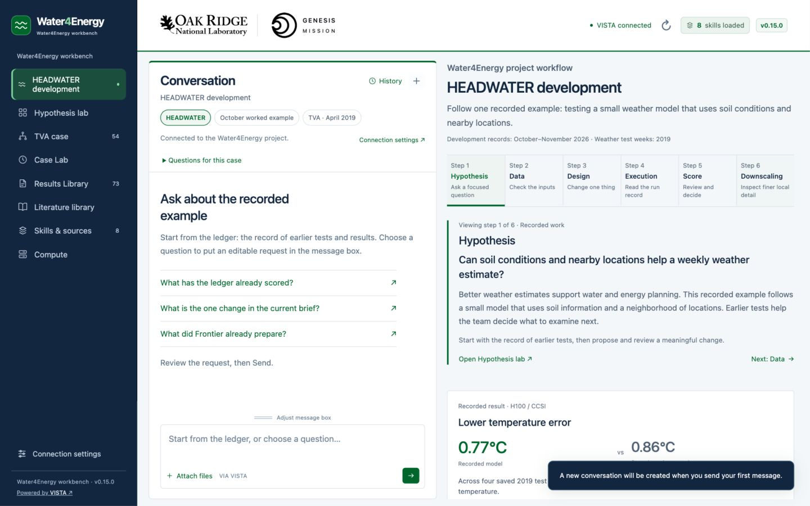
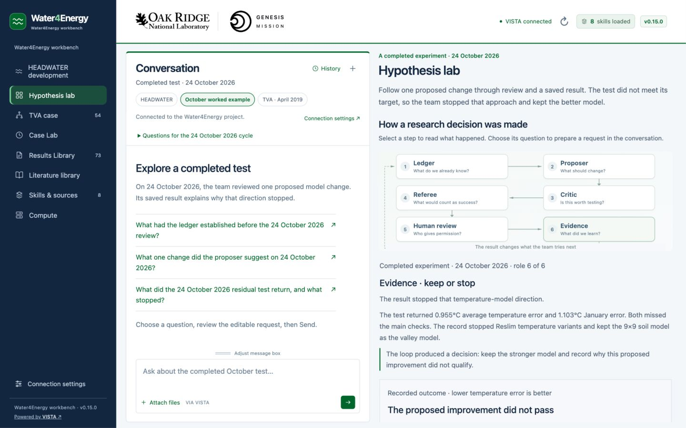
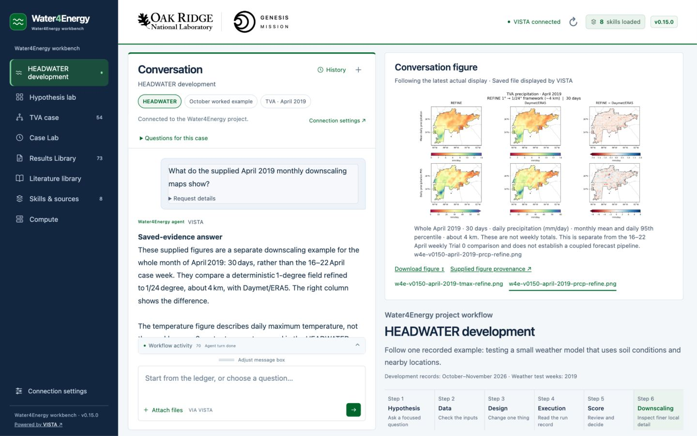

# Water4Energy workbench · v0.15.1

A project workbench for showing how recorded weather-model research informs water and energy questions. It opens on **HEADWATER development**, keeps conversation on the left, and puts the selected explanation or evidence on the right. VISTA supplies the agent, project storage and model connection.



## Launch one combined package

When using this repository checkout, the launcher is inside **Water4Energy-Workbench**. The downloadable ZIP uses the **TVA-Workbench** folder described below.

1. Extract **Water4Energy-Workbench-v0.15.1-All-in-One-Mac.zip** into a writable folder.
2. Double-click **Start TVA Workbench.command** inside `TVA-Workbench`.
3. Keep Terminal and VISTA open. Use the local address printed by this launcher.

Live chat requires **VISTA installed and your own model/provider credentials configured in VISTA Settings**. No separate setup bundle, GitHub login, npm or pip command is required. The launcher opens installed VISTA if needed, prepares eight saved-evidence skills and nine indexed documents, verifies the saved April evidence, and opens this interface copy. Indexing can take a few minutes. Python 3.9+ is required; VISTA normally supplies it.

An occupied port uses another available local port without stopping the existing process. Reopening the same extracted copy reuses its verified instance. Ctrl+C stops the workbench; VISTA remains under its own application's control. If backend setup needs attention, the interface can still open for design review. See **READ ME FIRST.txt**.

Known original v0.13.1, v0.13.2 and v0.14.0 backend installations can be verified, backed up and upgraded. Interface v0.14.1 delivered that same v0.14.0 backend. Unknown edits, shared global skills and differing evidence are preserved. Matching saved files retain their bytes and timestamps.

## Follow the three contexts

| Context | What to show |
| --- | --- |
| **HEADWATER development** | Start with the question, documented inputs, one specific change, recorded execution and measured limitations. A separate Downscaling example shows finer local detail. |
| **Hypothesis lab · 24 October 2026** | Walk one completed research cycle: earlier results → proposal → critique → referee's stopping rule → human gate → measured outcome. |
| **TVA · 16–22 April 2019** | Inspect the protected April-week weather, observed runoff and separate frozen Trial 0 comparison. |

Chat stays on the left while navigating the main views. Suggested questions fill an editable draft; **a person presses Send**. Case Lab gives the active conversation more room. Each context remembers its own draft and conversation. Switching is blocked during a turn, and late responses cannot replace evidence from another context. Drag **Adjust message box** to resize the composer. On narrow screens, the page stacks vertically.

The HEADWATER result is the **H100 / CCSI** model's temperature error across four saved 2019 target weeks: **0.77°C versus 0.86°C** for **the 1979–2017 week already in the example files**. Lower error is better. These are errors, not actual temperatures or an April-only score. The comparison does not isolate soil information alone; rain and some weeks remain weak. Lux lists its own run names without borrowing the H100 result.

The October example uses six original saved files from `20261024_track_review`, not a narrative invented for the interface. Its soil-residual model missed the primary stopping tests: four-week error **0.955 K**, January **1.103 K**. That research direction stopped. The pack requires human acceptance before training but supplies no separate acceptance receipt. The October example is distinct from the November proposals; the original HEADWATER answer still reports that no selected current November brief is established. Documentation dates in 2026 remain separate from weather test weeks in 2019.

## Keep the figures' scopes clear

The five supplied PNGs retain their source bytes and pinned provenance:

- Three comparison figures show four saved 2019 weeks. Their temperature maps show air temperatures; precipitation is weekly totals in mm. They do not depict the October soil-residual experiment.
- Two monthly refinement figures cover **all 30 days of April 2019**, at **1° to 1/24° (about 4 km)**. Rows show monthly mean and daily 95th percentile. Temperature is daily maximum temperature; precipitation is **mm/day**.

Those monthly figures are separate from the TVA case's frozen **Trial 0, 1° to 0.25°** comparison. Trial 0's standardized aggregate scores cover 730 days; its maps illustrate 19 April. Neither set establishes a connected HEADWATER forecasting/downscaling pipeline. The April runoff panel is a frozen chart derived from an **observed ERA5 receipt**, without a supplied runoff forecast or reservoir inflow prediction.

The six April guided questions, original guarded prompt catalog, case/evidence contract and **32 original staged evidence files** remain unchanged. The original HEADWATER saved-answer narratives are retained. New October/monthly files have separate names and contracts. A successful actual file display brings its figure into the evidence workspace; manual inspection pauses following and **Resume** returns to the latest display.





## Other views

**TVA case** introduces 54 study locations and the 12 headwater reservoirs. A network selection does not choose a live operating policy. **Results Library** and **Literature library** use compact lists. The literature catalog retains its 42-record snapshot; paper PDFs are not bundled. **Skills & sources** reads actual project readiness. **Compute** and **Connection settings** show resource connections, separately from historical run records or permission to execute.

All contexts use the single VISTA project **`Water4Energy-TVA-agent-loop`**. The default backend is `http://127.0.0.1:8001`. The ninth indexed guide explains the October cycle and monthly figures; the eight earlier documents stay unchanged.

The optional dam skill remains absent until an agreed reservoir and fill/hold rule exist. The exact original Trial 0 scorer command remains unavailable. The demonstration video/captions, approved home-score image and voiceover remain separately supplied content. Saved readers do not create a new experiment, review, score or execution approval. An unreadable provider response is shown as unavailable; preparing a retry still requires manual Send.

## Package and developer notes

The ZIP includes the interface, ORNL/Genesis marks, one launcher, setup code, pinned sources, eight adapters, nine lead documents and saved evidence. It excludes `.local/`, credentials, VISTA databases, chats, local project IDs, raw ERA5 arrays and checkpoints. Do not forward a previously launched folder's `.local/` directory.

This selectively integrates [the upstream workbench content](https://github.com/daliwang/water4energy_SC26Demo/tree/d0199a817ddbfa0fbf65c9e81d9fcc53081611ee/Water4Energy-Workbench) while retaining the combined runtime and source contracts. The UI is vanilla HTML/CSS/JavaScript with a Python standard-library wrapper. The **Powered by VISTA** credit links to [VISTA's repository](https://github.com/Genesis-VISTA/vista). Launcher filenames and project identity remain unchanged. The embedded `0.12.1` in the April case definition is historical case metadata, independent of interface version 0.15.1.

```sh
python3 -m unittest discover -s tests -v
python3 -m unittest discover -s backend/tests -v
node --test tests/*.cjs
```

Node is needed only for developer checks. After verification, `python3 tools/build_release.py --output /path/to/output` creates the complete ZIP and checks its hashes and launcher permissions. See [VERIFICATION.md](VERIFICATION.md) for test scope and limitations, [BACKEND.md](BACKEND.md) for API boundaries, [VISTA_SETUP.md](VISTA_SETUP.md) for installation details and [WORKFLOW_NOTES.md](WORKFLOW_NOTES.md) for scientific contexts. Previous versions remain in Git history.
