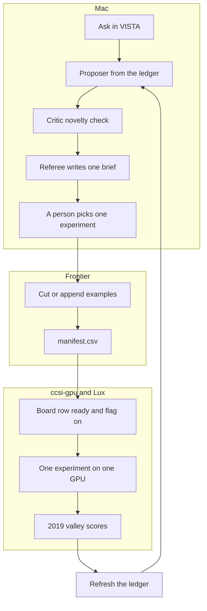

# Water4Energy workbench — agent loop and a short video

**Date:** 12 November 2026  
**Status:** Record of the loop that already exists, and a shot list for a short video inside the workbench.  
**Package:** `SC26_demo/Water4Energy-Workbench`, v0.2.0. Yang's workbench is v0.1.0. The on-screen name is Water4Energy workbench.

The 1979–2017 week already in the example files is the training reference. A named climate normal is a separate design and stays parked until the workflow is stable and the foundation model exists. See `Experiments/REVISIT_Clim_Protocol_After_HEADWATER.md`.

## What the loop already is

VISTA is where a person opens a question. The hypothesis lab is the science loop. One skill is one script plus a contract. The handoff between machines is a queue row and a manifest. An agent does not log into another machine to negotiate.

```text
Ask in VISTA
    → Proposer on the Mac, ledger first
    → Critic, novelty against the ledger
    → Referee writes one brief
    → a person picks one experiment
    → Frontier cuts or appends examples
    → one GPU trains, only if the row is ready and the flag is on
    → 2019 scores sync back
    → the ledger refreshes
    → the next brief
```



Numbers come only from `experiment_ledger.json`, `docs/INPUT_RUN_COMPARISON.json`, or a score file already on disk. A train starts only when a board row is `ready` and `human_flag` is true. One experiment uses one GPU.

## What has been walked

| Piece | State on 12 November 2026 |
|---|---|
| Spec, schemas, allowlist, four-week charge | Done |
| Ledger bootstrap and `seed_ledger.py` | Done. Scored runs block a re-proposal unless the change is stated |
| Proposer, Critic, Referee | Walked 18, 24, and 26 October. Packs are on disk |
| Skill contracts | Ledger, scores, literature, Frontier cut, board. `board.py` reads and does not launch |
| Example generation | Real. Version-1, root-zone soil, pressure, and later field appends. Synthetic files only checked the schema |
| Frontier dataset agent | Scripted. It runs a job whose dates and destination are already committed |
| GPU execution | Done on the H100s (`ccsi-gpu`). Focus C and the architecture wave were trained and scored there |
| Lux | Nine runs are named as scored on Lux in the 31 October sync list. Their score files are on Lux, not in this checkout |
| Ledger close and the next brief | Done after each scored wave. The 26 October referee brief is the current next-round note |
| Literature augmenter and gated downloads | Specified. The augmenter is still planned. Phase 3 downloads have not started |

**18 October, Focus C.** April maps, Critic pass, Referee. On the H100s, 2019 April valley persistence was 3.05 K, worse than the model and the historical week. Season-masked Niño and Gulf both failed.

**Through 24 October.** Root-zone soil moved the valley. The valley-temperature model is `det_v2_soil_k9`: **0.767 K** on the four 2019 weeks, against the 1979–2017 week at **0.861 K**. January, April, and October are ahead of that week. July is behind it, 1.260 K against 1.211 K. Reslim temperature variants were scored and closed. The best of them, the 2° trunk with a soil residual, is 0.955 K.

**26–27 October.** A 7-day filter and 850 hPa height each bring July under the historical week and give back the other three weeks. The CNN neighborhood search stops at the 9×9. The next trunk is attention along the 90 days. That block has no script and no board row.

April rain is the remaining miss on this model: observed valley sum 55.9 mm, historical week 24.4 mm, 9×9 map 24.7 mm. The sampler has not been built. These maps are deterministic.

## What the board is holding

Both H100s are free. Two rows are `ready`. Both have the training flag off.

| Row | Where | What it is allowed to do |
|---|---|---|
| April rain rank | Frontier | Read the soil files. No GPU. If 2019 sits outside the 1979–2017 departures, the column-water train stops |
| Lux device check | Lux, one MI355X | Print the device name. It does not train |
| Column water, `E_tcwv_9x9` | Designed | Waits on the rank file and a person |
| 90-day daily filter | Designed | An odd temporal kernel cannot see all 90 days |
| Temporal Reslim | Not a row | The written next trunk. No launch script |

## Short video

About **two minutes**. The subject is the agentic workflow on AmSC, and the leadership machines that workflow now uses. The clip ends on a deterministic example: Haoran’s April 2019 maps, a 1° field drawn at about 4 km.

The five beats, in this order:

1. **Hypothesis lab.** A question starts from the ledger. Proposer, Critic, and Referee.
2. **Data preparation.** Frontier runs a job whose dates and destination are already committed. The agent does not invent the protocol.
3. **Experiment design.** The brief names one change. A person picks that experiment and sets the training flag.
4. **Execution.** The same brief is what Lux and the other GPU hosts run. Nine run directories are listed as scored on Lux.
5. **Score.** The 2019 valley number comes back into the ledger, and the next brief is written from that ledger.
6. **A deterministic example.** Hold on Haoran’s 2019 maps. A 1° field, drawn at about 4 km. April maximum temperature, then April precipitation.

That carrying of design, data, execution, and score by agents, across AmSC and Frontier-class machines, is the line that this science did not have before. Say that. The large foundation model on thousands of GPUs stays the goal. It is not a machine count already in the log.

Capture the screens that v0.12.1 already has, the Connection cards for Frontier and Lux, and the two April figures below. The clip does not start a train, submit a job, or claim that a role ran because a button was clicked. It does not speak a Lux valley number. Those score files are on Lux, not in this checkout.

The closing pictures are already on disk, 3520×1870:

| File | What is on it |
|---|---|
| `Downscaling_Interface/refine_tva_2019/tmax/April_tmax_comparison.png` | Daily maximum temperature, April 2019, 30 days |
| `Downscaling_Interface/refine_tva_2019/prcp/April_prcp_comparison.png` | Precipitation, April 2019, 30 days |

Each figure is titled REFINED, 1° refined to 1/24° (about 4 km), beside Daymet/ERA5. The top row is the monthly mean. The bottom row is the daily 95th percentile. The right column is the difference. The same layout exists for daily minimum temperature, and for March, winter, spring, summer, and fall, under `tmax/`, `tmin/`, and `prcp/`. The product on these frames is deterministic. It is not a sample from an ensemble. These frames are Haoran’s downscaling result. They are not a claim that the HEADWATER forecast and this downscaler are already one pipeline.

Title card and narration use **Water4Energy workbench**. The captured UI may still show the current TVA labels until a rename pass. Say the product name in the voiceover. Do not cover the ORNL or Genesis marks. AmSC is named in the voiceover as the platform the agents run on. Do not substitute an AmSC logo for the Genesis mark.

### Where it sits

On **Hypothesis lab**, above the six-step map, as a local clip with a poster frame of that map. Play on click. No autoplay with sound. Captions on. The six nodes stay the thing a person clicks after the clip. Case Lab stays the live VISTA conversation. The video does not replace Send.

A later file can live at `TVA-Workbench/public/assets/water4energy-workbench-90s.mp4`. It is not in this checkout yet. The clip is a laptop capture plus the frozen April figures. It does not bundle checkpoints, the ledger, or example arrays.

### Shot list

| Time | Screen | What the picture shows | One spoken line |
|---|---|---|---|
| 0:00 | Title over Hypothesis lab | Water4Energy workbench. AmSC. | Agents now carry a model from a question to a score. |
| 0:12 | Hypothesis lab, six nodes | Ledger, Proposer, Critic, Referee, human gate, evidence | The hypothesis lab starts from what was already scored. |
| 0:28 | Case Lab, design question prepared | One proposed test, not a claim that the roles just ran | Design is one change. A critic checks that it is new. A referee writes one brief. |
| 0:46 | Frontier card, then a file count | 153 weekly cases, then the root-zone soil copy | Frontier prepares the data. The dates and the destination were already written down. |
| 1:04 | Lux card and the nine run names | Reslim observation run and the Lux wave | Lux runs the experiment. The same brief is the job. |
| 1:18 | Ledger return arrow | The score written back | The score comes home, and the next brief is written from it. |
| 1:28 | `April_tmax_comparison.png`, full frame | REFINED maximum temperature, April 2019, about 4 km | This is deterministic. A 1° field, drawn at about 4 kilometers. April maximum temperature. The middle map is the observation. |
| 1:44 | `April_prcp_comparison.png`, full frame | REFINED precipitation, April 2019, about 4 km | The same April, for precipitation. Mean above, the heavy days below. |
| 2:00 | Hypothesis lab, full map | The loop, then these two maps | Hypothesis, data, design, execution, and score, on AmSC and on these machines. The maps are what that loop is for. |

### What the video leaves out

- A tour of the kelvin table. One map is enough to show that a score returned.
- A Lux valley number. The files are on Lux.
- A count of thousands of GPUs as work already finished. That scale is the goal.
- A line that the loop has no person in it. A person still picks the experiment and sets the flag.
- A probability, an ensemble, or a funding-skill claim.
- A named climate normal in place of the 1979–2017 week in the files.
- A dam release, a fill policy, or a plant megawatt number.
- Any line that a clicked node started Proposer, Critic, or Referee.
- A line that these 4 km maps are already the HEADWATER forecast passed through the downscaler. They are Haoran’s deterministic 2019 refinement of a 1° field.

### Narration, read straight through

Water4Energy workbench, on AmSC.

The hypothesis lab opens from the ledger. A proposer turns an open gap into one test. A critic checks that the test is new. A referee writes one brief. A person chooses that experiment.

Frontier prepares the data. One hundred fifty-three weekly cases, then root-zone soil. The dates and the destination were already committed. The agent runs that job. It does not invent a new one.

Lux runs the experiment. The brief is the job. The score comes back to the same ledger, and the next brief is written from it.

One April map is the proof a loop closed. Then hold on the result. These frames are deterministic. A 1° field, refined to about 4 kilometers over the valley, for April 2019. Maximum temperature first. The middle panel is what was observed. Precipitation is the same month: the average, and the heavy days.

The point of the picture is the loop: hypothesis, data, design, execution, and score, on AmSC and on these machines. That is a way this research had not been carried before. The maps are what that loop is for.

## Sources

- `HEADWATER/hypothesis_lab/AGENT_LOOP.md`
- `HEADWATER/hypothesis_lab/STATUS.md`
- `HEADWATER/hypothesis_lab/RUNTIME.md`
- `HEADWATER/docs/PROGRAM_PLAN_EVALUATION.md`
- `HEADWATER/docs/EXPERIMENT_SUMMARY_20261023.md`
- `HEADWATER/docs/CNN_STOP_AND_TEMPORAL_20261027.md`
- `HEADWATER/docs/PARALLEL_BOARD.md`
- `TVA_demos/TVA-Workbench/README.md` and `WORKFLOW_NOTES.md`
- `TVA_demos/TVA-Workbench/public/hypothesis-guide.js` — the six nodes the clip walks
- `ProjectPlan_Tasks/AI_Team_Biweekly_20261109.md` — the same 0.767 K and April rain figures
- `PM_reports/comms_HEADWATER_20261112/FOR_COMMUNICATIONS.md` — the packet for communication staff, with the two valley maps
- `Downscaling_Interface/refine_tva_2019/` — Haoran’s deterministic 2019 REFINED maps, 1° to about 4 km. The demo ends on the April maximum-temperature and precipitation figures.
